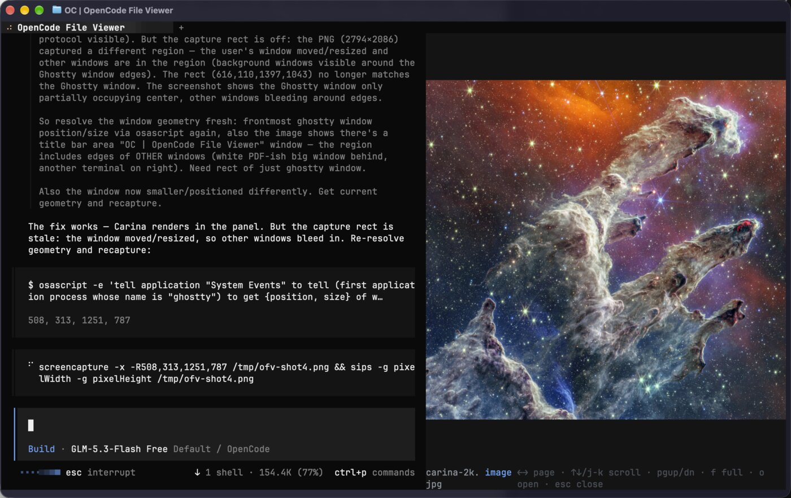

# opencode-file-viewer

An [OpenCode](https://opencode.ai) **2.x** plugin that views files inline in the terminal — images, PDFs, ebooks, office documents, Markdown, code, and data files. Requires the v2 plugin API; OpenCode 1.x is **not supported**.

Rendering uses [OpenTUI](https://opentui.com)'s image pipeline: Kitty graphics protocol (Kitty, Ghostty, WezTerm), Sixel, or a Unicode-block fallback on terminals without graphics support.



## Formats

| Formats | Pipeline | Notes |
| --- | --- | --- |
| PNG, WebP | direct render | full fidelity |
| JPEG, BMP, TIFF | [mupdf](https://mupdfjs.readthedocs.io) → PNG | decoded once, capped at terminal pixel geometry (terminal decoders are unreliable; direct JPEG render has stalled the TUI) |
| GIF | direct (static) / omggif (animated) | animated GIFs autoplay in-panel on their own delays |
| PDF | [mupdf](https://mupdfjs.readthedocs.io) (WASM) | pages render lazily, on demand |
| EPUB, CBZ | mupdf (WASM) | paged view |
| DOCX, PPTX, XLSX, DOC, PPT, XLS, ODT, ODS, ODP, RTF, SVG | LibreOffice → PDF → mupdf | requires `soffice` on PATH (`brew install --cask libreoffice`); first conversion takes a few seconds |
| Markdown | native OpenTUI renderer | with syntax-highlighted fences |
| JS/TS/JSX/TSX/Zig (bundled) + Python, Rust, C/C++, Go, Java, Kotlin, Swift, Objective-C, JSON, YAML, TOML | Tree-sitter | highlighted; any other text file renders plain |
| CSV, TSV | aligned monospace table | quoted cells handled |
| JSON | pretty-printed | |
| unknown / binary | text or hex dump | |
| HEIC | — | not supported (use `o` to open externally) |

## Install

Either the CLI:

```sh
opencode plugin add github:eddy-lau/opencode-file-viewer
```

or add it to `~/.config/opencode/opencode.json` (loads the server half and the TUI half automatically):

```jsonc
{
  "plugins": ["github:eddy-lau/opencode-file-viewer"]
}
```

For local development, point the entry at a checkout instead — or use the discovery directory, which needs no config entry:

```jsonc
{ "plugins": ["/Users/you/Projects/Personal/opencode-file-viewer"] }
```

```text
~/.config/opencode/plugins/opencode-file-viewer  # symlink/fs link to the checkout
```

Don't combine the last two: a config entry plus a discovery entry for the same plugin is a duplicate-ID conflict.

## Usage

Open a file yourself:

```
/view report.pdf          # open a file (relative to the workspace, ~ works)
/view                     # pick from viewable files in the workspace
```

or just ask the agent — it has a `view` tool and opens the panel itself:

> view the report

Then use the panel:

| Key | Action |
| --- | --- |
| `←` / `→` | previous / next page (paged formats) |
| `h` / `l` (or `p` / `n`) | same, vim-style |
| `↑` / `↓` | scroll by 3 lines (text formats); page turns on paged formats |
| `pgup` / `pgdn` | scroll a viewport (text) or a page (paged) |
| `j` / `k`, `g`, `shift+g` | scroll, top, bottom |
| `f` | toggle fullscreen |
| `o` | open in the system viewer (Preview etc.) |
| `esc` | close |

## Architecture

Two halves in one package (both loaded as one plugin):

- `src/index.ts` — server side: registers the agent-facing `view` tool; opening a file emits an event over plugin RPC
- `src/rpc.ts` — the `file-viewer` RPC channel (server → TUI bridge)
- `src/tui.tsx` — the TUI panel: subscribes to RPC events, also exposes the `/view` command

Formats are handled by a small registry (`src/handlers/`). Each handler maps a file to one of four content kinds the panel renders:

- `image` — a single image path, rendered via `<image>`; JPEG/BMP/TIFF decode to cached PNGs capped at terminal pixel geometry, animated GIFs decode to per-frame PNGs via `omggif` and autoplay
- `pages` — lazy per-page PNGs (PDF/EPUB/office), rendered via `<image>` with paging
- `animation` — decoded GIF frames; the panel advances on the GIF's own delays, `←→` step manually
- `markdown` — raw markdown, rendered via `<markdown>`
- `code` — source or text, rendered via `<code>` (Tree-sitter filetypes: OpenTUI's six plus the runtime-registered set in `src/lib/grammars.ts`, wasm+queries committed under `assets/grammars/` — provenance in `assets/grammars/SOURCES.md`)

Handlers are order-sensitive: the `code` handler claims every text extension and must stay last. Adding format support = new handler + registry entry.

Conversions are cached under `os.tmpdir()/opencode-file-viewer/<sha1(path+mtime+size)>/` and pruned after 7 days. Editing a file invalidates its cache automatically.

## Development

The TUI entry ships **precompiled** (`tui.js` at the repo root) — OpenCode's plugin loader transpiles plugin TSX with default React JSX and ignores per-plugin tsconfigs, so raw `.tsx` fails to load at runtime. `build.ts` uses `@opentui/solid`'s Bun plugin for the real JSX transform and fails if the result still contains `jsxDEV`/`jsx-runtime`. After editing `src/tui.tsx`:

```sh
bun run build      # requires bun; regenerates tui.js and must be committed with the source change
bunx tsc --noEmit  # typecheck
bun run smoke      # conversion pipeline smoke test (fixture paths from argv)
```

## Requirements

- OpenCode 2.x with its bundled Bun runtime (open on Linux, macOS, and Windows; office lookup understands Windows Program Files and macOS app bundles)
- Image fidelity depends on the terminal: Kitty-protocol terminals (Kitty, Ghostty, WezTerm) show full-resolution images; others fall back to Sixel or Unicode blocks
- Optional: LibreOffice for office formats and SVG (`brew install --cask libreoffice`, or your package manager)

## Known limitations

- The panel is session-scoped: open a session before `/view`
- The viewer's keymap layer is active while the panel is open; `h/j/k/l` are taken by it
- mupdf's WASM build has no SVG document handler, so SVG goes through LibreOffice- Animated GIFs autoplay (decoded per-frame; frames capped at 240 for pathological files)
- HEIC is not handled (mupdf can't decode it — use `o` for those)
- Native PNG/WebP images render pass-through at full resolution scaled to fit; JPEG/BMP/TIFF decodes are capped at the terminal's pixel geometry (fallback ~1400px)
- Syntax-highlighted fences cover the bundled Tree-sitter grammars (js/ts/jsx/tsx/md/zig); other languages render plain

## Roadmap

- [ ] npm publish

## License

MIT. The `mupdf` runtime dependency is AGPL-3.0 (loaded at runtime, not distributed here) — see [LICENSE](LICENSE).
